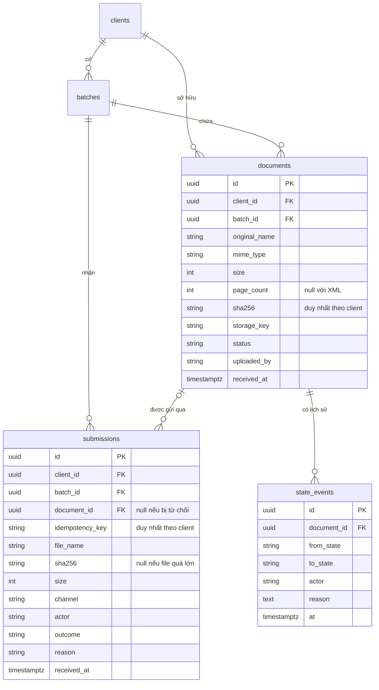
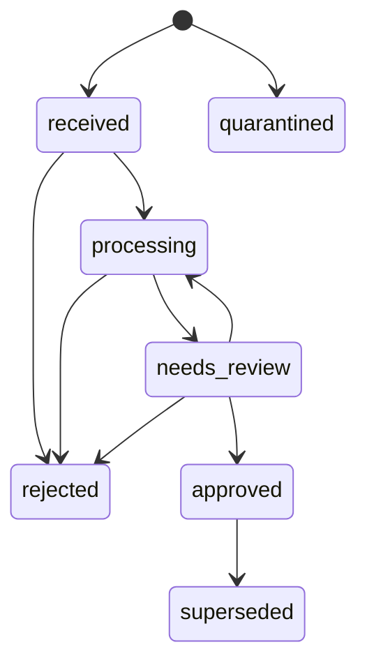

# G4T-10: Thiết kế API upload và cấu trúc dữ liệu Document

Phạm vi: story ST01. Người thực hiện: Lương Quốc An. Cần review: Lâm Chí Tâm (frontend), Trần Gia Thuận (tích hợp).
Đặc tả máy đọc được: [`openapi.yaml`](openapi.yaml), xuất trực tiếp từ code nên luôn khớp với API.

## 1. Quyết định chính

| Quyết định | Lý do | RFP |
| --- | --- | --- |
| Tải file theo lô, lô gắn với khách hàng | Không để dữ liệu thiếu chủ sở hữu | ING 01 |
| Mỗi request một file; chọn nhiều file thì frontend gửi lần lượt | Mỗi file có kết quả riêng | ING 02 |
| Document ID là UUID do server tạo | Không đoán được, không phụ thuộc tên file | ST01 |
| Tách `documents` và `submissions` | Một file gửi nhiều lần vẫn là một tài liệu, nhưng mọi lần gửi đều được ghi | ING 02, ING 05 |
| Chống trùng theo `client_id + sha256` | Không so trùng giữa các khách hàng | ING 05 |
| Loại file xác định theo nội dung | Không tin đuôi file và header của trình duyệt | ING 03 |
| File lỗi trả mã 4xx có `error_code` | Frontend hiển thị được lỗi cụ thể | ST01 |
| Upload chỉ tạo trạng thái `received` | Trích xuất thuộc luồng xử lý nền | ARC 02 |

## 2. API

`POST /batches/{batch_id}/documents`

- Body: `multipart/form-data`, trường `file`.
- Header: `Idempotency-Key` (bắt buộc, tối đa 128 ký tự). Frontend sinh một UUID cho mỗi file được chọn và dùng lại đúng UUID đó khi thử lại.
- Xác thực: tạm dùng `X-User` và `X-Client-Ids`; sẽ thay bằng Keycloak.

| HTTP | Khi nào |
| --- | --- |
| 201 | Tài liệu mới |
| 200 | Đã có tài liệu này; trả Document ID cũ, `duplicate: true` |
| 4xx | Xem bảng lỗi |

```json
{
  "document_id": "3f2b8c1e-7a10-4c55-9a55-0f6a3e8d1b77",
  "submission_id": "b0e1f6f2-52ad-4a39-8a23-1a7c6f0d9e10",
  "batch_id": "9c41d3a4-2f7e-4e0e-8d3b-6b1f4a7c2e55",
  "file_name": "hoadon.xml",
  "size": 18234,
  "sha256": "c1d3126dfa44...",
  "mime_type": "application/xml",
  "page_count": null,
  "channel": "browser",
  "uploaded_by": "nhanvien.dev",
  "status": "received",
  "duplicate": false,
  "received_at": "2026-11-09T13:19:00Z"
}
```

Lỗi có dạng:

```json
{ "error_code": "file_too_large", "message": "File vượt quá giới hạn 20 MiB.", "submission_id": "...", "document_id": null }
```

| HTTP | `error_code` | Ghi lại lần gửi | Lưu file |
| --- | --- | --- | --- |
| 400 | `empty_file` | Có, trừ khi request không có file | Không |
| 400 | `missing_idempotency_key`, `invalid_idempotency_key` | Không | Không |
| 401 | `unauthenticated` | Không | Không |
| 404 | `not_found` (không tồn tại hoặc không có quyền) | Không | Không |
| 409 | `idempotency_key_conflict` | Không | Không |
| 413 | `file_too_large` | Có | Không |
| 415 | `unsupported_format`, `archive_not_supported` | Có | Không |
| 415 | `extension_content_mismatch` | Có | Có, trạng thái `quarantined` |
| 422 | `too_many_pages`, `corrupt_file`, `password_protected` | Có | Không |
| 422 | `active_content`, `unsafe_xml` | Có | Có, trạng thái `quarantined` |
| 422 | `quarantined` (gửi lại file đang bị cách ly) | Có | Không ghi thêm |

API phụ: `GET /documents/{document_id}` xem trạng thái, `GET /batches/{batch_id}/manifest` xem mọi lần gửi trong lô.

## 3. Dữ liệu



`outcome` nhận một trong: `accepted`, `duplicate`, `rejected`, `quarantined`.

## 4. Trạng thái (RFP Annex B)



`exported` là sự kiện trên bản đã duyệt, không phải trạng thái. Không có đường đi tự động từ `processing` sang `approved`.

## 5. Bàn giao

**Tâm (frontend)**
- Gọi một request cho mỗi file; sinh `Idempotency-Key` khi người dùng chọn file.
- Hiển thị `message` khi lỗi, và phân biệt 201 với 200 (`duplicate: true`).
- Dùng `document_id` làm mã tài liệu trên giao diện.

**Thuận (tích hợp)**
- Đề xuất: worker lấy các dòng `documents.status = 'received'`, đã có index trên cột này.
- Đổi trạng thái qua `check_transition` và luôn ghi thêm `state_events`.
- Đọc file bằng `storage_key`; không sửa bản gốc.

## 6. Câu hỏi cần chốt khi review

1. PO có đồng ý đưa `batch_id` và `Idempotency-Key` vào ST01 không?
2. Thuận chọn lấy việc bằng cách quét trạng thái `received` hay API đẩy `document_id` vào hàng đợi?
3. RFP còn có `entity_id` (DAT 01). Mỗi khách hàng có thể có nhiều pháp nhân không? Thiết kế này đang coi một khách hàng là một pháp nhân.
4. Đô sẽ thay kho lưu cục bộ bằng MinIO ở CV10 theo giao diện `put` và `get` hiện có, đồng ý không?

## 7. Ngoài phạm vi ST01

OCR, phân loại, trích xuất, quét mã độc, đăng nhập thật, Row Level Security và MinIO thuộc các story khác. Giới hạn dung lượng ở tầng ứng dụng chỉ bảo vệ bộ nhớ; khi triển khai cần đặt thêm giới hạn request ở reverse proxy.
