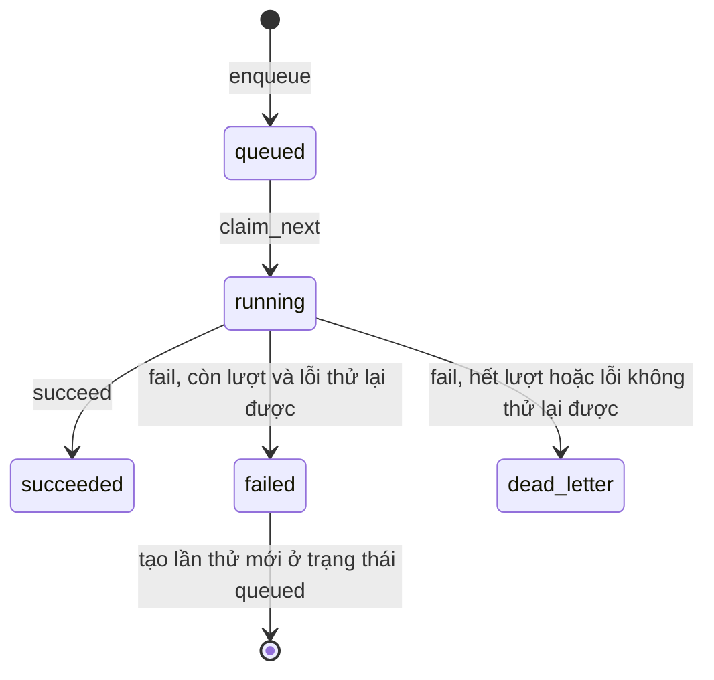

# G4T-66: Thiết kế schema processing job

Story: ST05 Background Processing & Durable Job Queue (G4T-39). Người thực hiện: Lương Quốc An.
Cần review: Trần Gia Thuận (hàng đợi, worker), Nguyễn Thanh Khiêm (kiểm thử).

Code: bảng `processing_jobs` trong `backend/app/models.py`, vòng đời job trong `backend/app/jobs.py`,
migration `backend/migrations/versions/0002_processing_jobs.py`, test `backend/tests/test_processing_jobs.py`.

## 1. Quyết định chính

| Quyết định | Lý do | RFP |
| --- | --- | --- |
| Mỗi dòng là một lần thử; thử lại tạo dòng mới với `attempt_no + 1` | Giữ nguyên lịch sử từng lần thử, không ghi đè lỗi cũ | ARC 02, DAT 04 |
| Chỉ một job `queued` hoặc `running` cho mỗi tài liệu và loại việc, chặn ở tầng database | Gửi lại hoặc worker khởi động lại không tạo việc trùng | ARC 02 |
| `input_sha256` lưu mã băm bản gốc lúc tạo job; worker kiểm tra lại trước khi xử lý | Phát hiện bản gốc bị sửa hoặc mất; worker chỉ đọc, không ghi | ING 04 |
| Lỗi chỉ lưu mã và câu thông báo trong danh sách cho phép | Không để chữ trong tài liệu, đường dẫn hay stack trace lọt vào database | SEC 04, Annex B |
| Thử lại có giới hạn, chờ tăng dần, hết lượt thì `dead_letter` | Lỗi tạm thời được thử lại; lỗi kéo dài không lặp vô hạn | ARC 02, ARC 04 |
| Worker giữ việc có thời hạn (lease); quá hạn thì job được thu hồi và thử lại | Worker bị tắt giữa chừng không làm job kẹt ở `running` | ARC 02 |
| Nhận việc bằng `SELECT ... FOR UPDATE SKIP LOCKED` | Hai worker chạy song song không nhận cùng một job | ARC 02 |
| `correlation_id` giữ nguyên qua mọi lần thử | Lần theo một yêu cầu xuyên qua API, worker và log | OPS 01 |

## 2. Bảng `processing_jobs`

| Cột | Kiểu | Ý nghĩa |
| --- | --- | --- |
| `id` | UUID | `job_id` của lần thử này |
| `client_id` | UUID | Khách hàng sở hữu tài liệu, để cách ly dữ liệu |
| `document_id` | UUID | Tài liệu được xử lý |
| `job_type` | chuỗi | Loại việc; hiện có `extract` |
| `status` | chuỗi | `queued`, `running`, `succeeded`, `failed`, `dead_letter` |
| `attempt_no` | số | Lần thử thứ mấy, bắt đầu từ 1 |
| `max_attempts` | số | Số lần thử tối đa, mặc định 3 |
| `retry_of_job_id` | UUID | Lần thử trước mà dòng này thay thế |
| `correlation_id` | chuỗi | Mã lần theo; tự sinh nếu không truyền vào |
| `input_sha256` | chuỗi | Mã băm bản gốc lúc tạo job |
| `processor_version` | chuỗi | Phiên bản parser hoặc OCR đã chạy (ARC 03) |
| `locked_by`, `lease_expires_at` | chuỗi, thời gian | Worker đang giữ việc và hạn giữ việc |
| `created_at`, `next_attempt_at` | thời gian | Lúc tạo và lúc sớm nhất được nhận việc |
| `started_at`, `finished_at`, `updated_at` | thời gian | Mốc bắt đầu, kết thúc, cập nhật |
| `error_code`, `error_message`, `error_retryable` | chuỗi, chuỗi, đúng sai | Thông tin lỗi an toàn |

Ràng buộc và chỉ mục:

- `uq_jobs_one_active`: duy nhất theo (`document_id`, `job_type`) khi `status` là `queued` hoặc `running`.
- `uq_jobs_document_type_attempt`: duy nhất theo (`document_id`, `job_type`, `attempt_no`).
- `ix_jobs_status_next_attempt`: để worker tìm job đến hạn nhanh.

## 3. Trạng thái job



Trạng thái job tách khỏi trạng thái tài liệu. Worker vẫn phải đổi trạng thái tài liệu qua `states.check_transition`
và ghi `state_events`: `received` sang `processing` khi bắt đầu, sang `needs_review` khi job thành công.

## 4. Mã lỗi an toàn

| `error_code` | Thử lại | Khi nào |
| --- | --- | --- |
| `original_missing` | Không | Không tìm thấy bản gốc |
| `original_tampered` | Không | Mã băm bản gốc không khớp |
| `unsupported_document` | Không | Loại tài liệu chưa hỗ trợ |
| `parser_error` | Không | Không đọc được cấu trúc tài liệu |
| `ocr_timeout` | Có | Dịch vụ OCR phản hồi quá thời gian |
| `ocr_unavailable` | Có | Dịch vụ OCR tạm thời không dùng được |
| `quota_exceeded` | Có | Chạm hạn mức dịch vụ |
| `lease_expired` | Có | Worker không báo kết quả trước hạn giữ việc |
| `internal_error` | Có | Mọi lỗi khác; mã lạ cũng được quy về đây |

Thời gian chờ trước lần thử kế tiếp: 30 giây, 60 giây, 120 giây..., tối đa 15 phút.

## 5. Bàn giao cho Thuận (worker)

```python
from app import jobs

job = jobs.enqueue(db, document, correlation_id=request_id)   # sau khi tài liệu ở trạng thái received
db.commit()

job = jobs.claim_next(db, worker_id="worker-1")               # trong vòng lặp của worker
db.commit()
if job:
    try:
        data = jobs.read_original(store, db, job)              # chỉ đọc, đã kiểm tra mã băm
        ...                                                    # gọi trích xuất của Vy
        jobs.succeed(db, job, processor_version="xml-mapping-v1")
    except jobs.JobError as err:
        jobs.fail(db, job, err.code)
    db.commit()

jobs.reclaim_expired(db)                                       # chạy định kỳ để thu hồi job kẹt
```

## 6. Câu hỏi cần chốt khi review

1. Thuận: giữ cách worker quét bảng `processing_jobs`, hay đẩy `job_id` vào Redis/Celery và dùng bảng này làm nguồn sự thật?
2. Ai gọi `enqueue`: API ngay sau khi tải lên thành công, hay một tác vụ định kỳ quét tài liệu `received`?
3. Giá trị mặc định 3 lần thử, chờ 30 giây, giữ việc 10 phút có phù hợp với OCR không?

## 7. Ngoài phạm vi G4T-66

Worker thật, Celery/Redis, gọi OCR, đổi trạng thái tài liệu và màn hình theo dõi hàng đợi thuộc các subtask khác của ST05.
