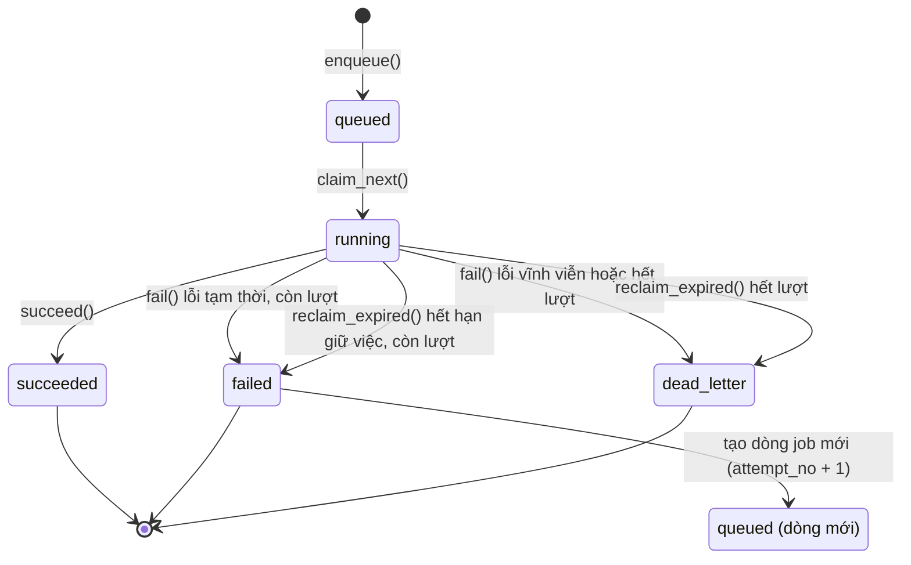

# G4T-67 · ST05.2 · State machine của processing job

Người làm: Lương Quốc An · Story cha: G4T-39 (ST05) · Dựa trên: G4T-66 (`docs/G4T-66-thiet-ke-processing-job.md`)

Mục tiêu theo Jira: quy định các trạng thái và chuyển trạng thái được phép của job
(QUEUED → RUNNING → SUCCEEDED/FAILED), gồm cả thử lại, ghi rõ chuyển không hợp lệ và trạng thái cuối.

Code: `backend/app/jobs.py` (`JOB_ALLOWED`, `check_job_transition`, `TERMINAL_JOB_STATUSES`, `ACTIVE_JOB_STATUSES`)
Test: `backend/tests/test_job_state_machine.py`
Migration: `backend/migrations/versions/0003_job_state_checks.py`

## 1. Các trạng thái

| Trạng thái | Ý nghĩa | Loại |
|---|---|---|
| `queued` | Job đã tạo, chờ worker nhận (có thể đang chờ đến `next_attempt_at` nếu là lần thử lại) | Đang hoạt động |
| `running` | Một worker đã nhận job, đang giữ việc đến `lease_expires_at` | Đang hoạt động |
| `succeeded` | Xử lý xong, kết quả đã lưu | Cuối |
| `failed` | Lần thử này lỗi nhưng **đã có lần thử mới** được xếp hàng | Cuối (của dòng này) |
| `dead_letter` | Lỗi không thử lại được, hoặc đã hết số lần thử | Cuối |

Quy ước quan trọng: **mỗi dòng trong `processing_jobs` là một lần thử**. Thử lại không đưa dòng cũ
về `queued`; nó tạo dòng mới với `attempt_no + 1`, cùng `correlation_id`, `retry_of_job_id` trỏ về dòng cũ.
Nhờ vậy lịch sử từng lần thử còn nguyên để kiểm toán (DAT 04, OPS 01).

## 2. Sơ đồ

## 3. Bảng chuyển trạng thái được phép

| Từ | Sang | Hàm | Điều kiện |
|---|---|---|---|
| (không có) | `queued` | `enqueue` | Tài liệu không ở `quarantined`/`rejected`; chưa có job đang hoạt động cùng loại |
| `queued` | `running` | `claim_next` | `next_attempt_at <= now`; khóa dòng bằng `SKIP LOCKED` |
| `running` | `succeeded` | `succeed` | Worker báo xong |
| `running` | `failed` | `fail` / `reclaim_expired` | Lỗi thử lại được và `attempt_no < max_attempts`; tạo dòng `queued` mới cùng lúc |
| `running` | `dead_letter` | `fail` / `reclaim_expired` | Lỗi không thử lại được, hoặc `attempt_no = max_attempts` |

Thời gian chờ trước lần thử lại: 30 giây × 2^(n−1), tối đa 15 phút (n là số lần thử vừa lỗi).

## 4. Chuyển không hợp lệ (bị chặn)

Mọi cặp không có trong bảng trên đều bị `check_job_transition` từ chối bằng `IllegalJobTransition`
kèm lý do. Test `test_full_transition_matrix` kiểm đủ 25 cặp (5 × 5). Các trường hợp hay gặp:

| Chuyển | Vì sao chặn |
|---|---|
| `queued → succeeded/failed/dead_letter` | Job chưa chạy thì không có kết quả; phải qua `running` |
| `running → queued` | Không "trả lại" job; hết hạn giữ việc được xử lý bằng `reclaim_expired` (ghi lỗi `lease_expired` rồi tạo dòng mới) |
| `failed → queued` / `failed → running` | Lần thử lại là dòng mới, không sửa dòng cũ |
| `succeeded → bất kỳ` | Trạng thái cuối; muốn xử lý lại thì `enqueue` tạo job mới |
| `dead_letter → bất kỳ` | Trạng thái cuối; cần người xem xét trước khi `enqueue` lại |
| `X → X` (giữ nguyên) | Không có ý nghĩa, dễ che lỗi gọi hàm hai lần |
| Giá trị lạ (`done`, `QUEUED`, rỗng) | Không thuộc enum; database cũng chặn bằng `ck_jobs_status` |

Hai lớp bảo vệ:
1. **Code**: mọi hàm đổi trạng thái gọi `check_job_transition` trước khi ghi.
2. **Database** (migration 0003): `ck_jobs_status` chỉ nhận 5 giá trị trên; `ck_jobs_attempt_range` buộc
   `1 <= attempt_no <= max_attempts`. Kết hợp với index `uq_jobs_one_active` của G4T-66 (mỗi tài liệu tối đa
   một job `queued`/`running` cho mỗi loại việc).

## 5. Vì sao có thêm `dead_letter` (đề nghị PO xác nhận)

Jira G4T-39 ghi 4 trạng thái QUEUED/RUNNING/SUCCEEDED/FAILED. Thiết kế giữ thêm `dead_letter` vì:

- **Phân biệt "sẽ tự thử lại" và "cần người xử lý".** Nếu chỉ có `failed`, màn hình và worker không biết
  lỗi đó đã có lần thử mới hay đã bỏ cuộc. Với `dead_letter`, câu hỏi "tài liệu nào đang kẹt cần người xem"
  chỉ là một truy vấn `status = 'dead_letter'`.
- **RFP ghi rõ yêu cầu này.** ARC 02: *"Use a durable queue, per document state machine, idempotent jobs,
  bounded retries and dead letter handling."* OPS 01 yêu cầu giám sát số lỗi và tuổi hàng đợi; DAT 04 yêu cầu
  lưu lỗi và số lần thử của mỗi lần xử lý. `dead_letter` là phần "dead letter handling" của ARC 02.
- **Vẫn tương thích với 4 trạng thái của Jira.** Nếu PO muốn giao diện chỉ hiện 4 trạng thái, API có thể
  hiển thị `dead_letter` là `FAILED` kèm cờ `retryable = false` (G4T-68 sẽ quy định). Bảng dữ liệu không đổi.

> Câu hỏi cho PO (anh Hùng): đồng ý giữ trạng thái `dead_letter` như trên không? Nếu không, phương án thay thế
> là bỏ `dead_letter`, dùng `failed` + `error_retryable` + "không có dòng thử lại" để suy ra — chạy được nhưng
> truy vấn và hiển thị phức tạp hơn.

## 6. Quan hệ với trạng thái tài liệu (Annex B)

Trạng thái job và trạng thái tài liệu là hai state machine riêng. Job **không** tự đổi trạng thái tài liệu;
worker (Thuận, G4T-70) làm việc đó qua `states.check_transition`. Đề xuất ánh xạ để Thuận dùng:

| Sự kiện job | Trạng thái tài liệu |
|---|---|
| Job đầu tiên chuyển `running` | `received → processing` |
| `succeeded` | `processing → needs_review` (INT 06: Core không tự phát hành) |
| `failed` (đã có lần thử mới) | Giữ `processing` |
| `dead_letter` | Giữ `processing`, hiện trong danh sách cần xử lý; người duyệt quyết định `enqueue` lại hoặc `rejected` |

## 7. Ngoài phạm vi

- Hủy job (`cancelled`): chưa có yêu cầu trong RFP/Jira, không thêm để tránh trạng thái thừa.
- Worker, hàng đợi, API đọc trạng thái job: G4T-69/70 (Thuận) và G4T-68 (hợp đồng API).
