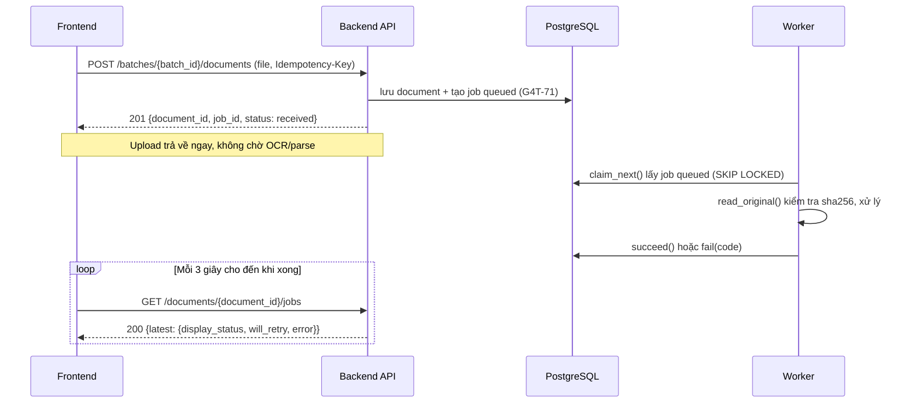

# G4T-68 · ST05.3 · Hợp đồng API xử lý nền

Người làm: Lương Quốc An · Story cha: G4T-39 (ST05) · Dựa trên: G4T-66 (schema job), G4T-67 (state machine)

Mục tiêu theo Jira: thống nhất request/response, mã trạng thái HTTP, định dạng lỗi và các định danh giữa
**Backend**, **Frontend** và **worker xử lý**; ghi rõ endpoint và payload ví dụ.

| Bên | Người | Dùng phần nào |
|---|---|---|
| Backend (API) | An | Mục 3–6: đã cài `GET /jobs/{job_id}`, `GET /documents/{document_id}/jobs` |
| Backend (upload ↔ hàng đợi) | Thuận, G4T-71 | Mục 4.1: thêm `job_id` vào phản hồi upload |
| Worker | Thuận, G4T-69/G4T-70 | Mục 7: hàm Python trong `backend/app/jobs.py` |
| Frontend | Tâm | Mục 4, 5, 8: hiển thị trạng thái và hỏi lại (polling) |
| Kiểm thử | Khiêm, G4T-72 | Toàn bộ; test mẫu ở `backend/tests/test_job_api.py` |

Code: `backend/app/main.py`, `backend/app/schemas.py` (`JobOut`, `JobList`, `JobErrorOut`), `backend/app/jobs.py`
(`DISPLAY_STATUS`). Đặc tả máy đọc: `docs/openapi.yaml`.

## 1. Luồng tổng quát



## 2. Định danh

Mọi định danh là chuỗi UUID v4, do backend sinh; client không tự đặt (trừ `Idempotency-Key` và tùy chọn `correlation_id`).

| Định danh | Sinh khi | Ý nghĩa | Ai giữ |
|---|---|---|---|
| `client_id` | Tạo khách hàng | Phạm vi dữ liệu (cách ly theo khách hàng) | Mọi bảng |
| `batch_id` | Tạo đợt nộp | Một lần thu thập chứng từ | Frontend chọn trước khi upload |
| `submission_id` | Mỗi lần gửi file | Một lần gửi, kể cả gửi trùng hay bị từ chối | Manifest |
| `document_id` | File mới (theo sha256 trong khách hàng) | Tài liệu duy nhất; gửi trùng trả lại cùng id | Upload, job, kết quả parse |
| `job_id` | Mỗi lần thử xử lý | Một dòng `processing_jobs` | Worker, API job, kết quả parse |
| `correlation_id` | Lần thử đầu tiên | Giữ nguyên qua mọi lần thử lại; dùng để lọc log | Log, API job |
| `attempt_no` | Mỗi lần thử | 1, 2, 3… trong cùng `document_id` + `job_type` | API job |
| `sha256` | Upload | Mã băm bản gốc; job lưu lại để kiểm tra bản gốc không đổi | Upload, worker |

Kết quả xử lý (G4T-61 XML, G4T-62 PDF) **phải** mang cả `document_id` và `job_id` để truy vết lần thử đã tạo ra nó.

## 3. Quy ước chung

- JSON UTF-8. Thời gian là ISO 8601 theo UTC, kết thúc bằng `Z`, ví dụ `2026-11-20T01:00:40Z`.
- Xác thực tạm (môi trường phát triển): header `X-User` và `X-Client-Ids` (danh sách `client_id`, phân tách bằng dấu phẩy).
  Sẽ thay bằng Keycloak ở Sprint sau (SEC 01); hợp đồng response không đổi.
- Dữ liệu của khách hàng khác trả **404 `not_found`**, giống như không tồn tại, để không lộ thông tin.
- Không bao giờ trả nội dung tài liệu, đường dẫn lưu trữ, tên worker, hạn giữ việc hay nội dung exception.

## 4. Endpoint

### 4.1 `POST /batches/{batch_id}/documents` (đã có, G4T-71 bổ sung `job_id`)

Request và các lỗi giữ nguyên như `docs/G4T-10-thiet-ke-api-upload.md`. G4T-71 thêm một trường:

| Trường | Kiểu | Quy tắc |
|---|---|---|
| `job_id` | `string \| null` | File mới hợp lệ: id của job `queued` vừa tạo. Gửi trùng (200): job mới nhất của tài liệu đã có. File bị cách ly/từ chối: không có job, trả lỗi như hiện tại. |

> **Tình trạng (21/11):** PR #20 (G4T-71) đã tự tạo job `queued` sau mỗi upload hợp lệ, nhưng phản hồi upload
> **chưa có `job_id`**. Trong lúc chờ, Frontend lấy job qua `GET /documents/{document_id}/jobs` (mục 4.3).

Upload phải trả về ngay sau khi lưu bản gốc và tạo job; không chờ worker. Cấu trúc phản hồi hiện tại (chưa có `job_id`;
giá trị trong `<…>` là mô tả kiểu, không phải dữ liệu):

```json
{
  "document_id": "<uuid>",
  "submission_id": "<uuid>",
  "batch_id": "<uuid>",
  "file_name": "<tên file gốc, đã làm sạch>",
  "size": "<số byte>",
  "sha256": "<64 ký tự hex>",
  "mime_type": "application/xml | application/pdf | image/jpeg | image/png",
  "page_count": "<số trang | null>",
  "channel": "browser",
  "uploaded_by": "<X-User>",
  "status": "received",
  "duplicate": false,
  "received_at": "<ISO 8601 UTC, kết thúc bằng Z>"
}
```

### 4.2 `GET /jobs/{job_id}` (đã cài)

Trạng thái một lần thử. Mã: 200, 401, 404. Giá trị trong `<…>` là mô tả kiểu.

```json
{
  "job_id": "<uuid>",
  "document_id": "<uuid>",
  "job_type": "extract",
  "status": "queued",
  "display_status": "QUEUED",
  "will_retry": false,
  "attempt_no": 1,
  "max_attempts": 3,
  "retry_of_job_id": null,
  "correlation_id": "<uuid hoặc id do client gửi>",
  "processor_version": null,
  "created_at": "<ISO 8601 UTC>",
  "next_attempt_at": "<ISO 8601 UTC>",
  "started_at": null,
  "finished_at": null,
  "duration_ms": null,
  "error": null
}
```

| Trường | Ý nghĩa |
|---|---|
| `status` | Trạng thái chi tiết theo G4T-67: `queued`, `running`, `succeeded`, `failed`, `dead_letter` |
| `display_status` | 4 trạng thái cho giao diện theo G4T-39: `QUEUED`, `RUNNING`, `SUCCEEDED`, `FAILED` (`dead_letter` hiện là `FAILED`) |
| `will_retry` | `true` khi lần thử này lỗi nhưng đã có lần thử mới xếp hàng; `false` ở mọi trường hợp khác |
| `next_attempt_at` | Lần thử này được phép chạy từ lúc nào (lần thử lại có thời gian chờ) |
| `duration_ms` | Thời lượng lần thử (từ `started_at` đến `finished_at`), `null` khi chưa chạy xong; dùng cho lịch sử chạy G4T-76 |
| `error` | `null` hoặc `{code, message, retryable}`; `message` lấy từ danh sách cố định, an toàn để hiển thị |

### 4.3 `GET /documents/{document_id}/jobs?job_type=extract` (đã cài)

Lịch sử các lần thử của một tài liệu, cũ trước mới sau. `latest` là lần thử mới nhất (hoặc `null` nếu chưa có job).
`job_type` mặc định `extract`. Mã: 200, 401, 404. Cấu trúc khi lần thử 1 lỗi tạm thời và lần thử 2 đang chờ:

```json
{
  "document_id": "<uuid A>",
  "latest": { "job_id": "<uuid C>", "status": "queued", "display_status": "QUEUED", "attempt_no": 2,
              "retry_of_job_id": "<uuid B>", "next_attempt_at": "<ISO 8601 UTC>", "error": null, "…": "…" },
  "items": [
    {
      "job_id": "<uuid B>",
      "status": "failed",
      "display_status": "FAILED",
      "will_retry": true,
      "attempt_no": 1,
      "started_at": "<ISO 8601 UTC>",
      "finished_at": "<ISO 8601 UTC>",
      "error": { "code": "ocr_timeout", "message": "Dịch vụ OCR phản hồi quá thời gian.", "retryable": true },
      "…": "các trường còn lại như 4.2"
    },
    { "job_id": "<uuid C>", "status": "queued", "attempt_no": 2, "…": "…" }
  ]
}
```

Endpoint này là cách Frontend nên dùng: chỉ cần `document_id` (có ngay sau upload) và luôn thấy lần thử mới nhất,
kể cả khi job đã được thử lại với `job_id` mới.

## 5. Mã trạng thái HTTP

| Mã | Khi nào | `error_code` |
|---|---|---|
| 200 | Đọc thành công; upload trùng | — |
| 201 | Upload file mới | — |
| 400 | Thiếu file, thiếu/sai `Idempotency-Key` | `empty_file`, `missing_idempotency_key`, `invalid_idempotency_key` |
| 401 | Chưa đăng nhập | `unauthenticated` |
| 404 | Không có hoặc thuộc khách hàng khác | `not_found` |
| 409 | `Idempotency-Key` đã dùng cho file khác | `idempotency_key_conflict` |
| 413 / 415 / 422 | File không nhận được (quá lớn, sai định dạng, không an toàn…) | xem `backend/app/errors.py` |

Lỗi **xử lý** (OCR hết giờ, parse hỏng…) **không** trả mã HTTP lỗi: upload đã thành công, lỗi xử lý nằm trong
trường `error` của job (mục 6.2).

## 6. Định dạng lỗi

### 6.1 Lỗi HTTP (giữ nguyên định dạng hiện có)

```json
{
  "error_code": "not_found",
  "message": "Không tìm thấy dữ liệu hoặc bạn không có quyền truy cập.",
  "submission_id": null,
  "document_id": null
}
```

Frontend dựa vào `error_code` để xử lý; `message` là câu tiếng Việt có thể hiển thị thẳng.

### 6.2 Lỗi xử lý trong job

| `error.code` | `retryable` | Ý nghĩa |
|---|---|---|
| `original_missing` | false | Không tìm thấy bản gốc |
| `original_tampered` | false | Mã băm bản gốc không khớp, dừng xử lý |
| `unsupported_document` | false | Loại tài liệu chưa hỗ trợ |
| `parser_error` | false | Không đọc được cấu trúc tài liệu |
| `xml_unsafe` | false | XML có DTD/entity/tham chiếu ngoài (G4T-61) |
| `xml_malformed` | false | XML sai cú pháp (G4T-61) |
| `xml_unsupported_variant` | false | XML không thuộc chuẩn đang hỗ trợ (G4T-61) |
| `xml_schema_invalid` | false | XML thiếu phần bắt buộc hoặc có nhiều hóa đơn (G4T-61) |
| `ocr_timeout` | true | OCR quá thời gian |
| `ocr_unavailable` | true | OCR tạm không dùng được |
| `quota_exceeded` | true | Chạm hạn mức dịch vụ |
| `lease_expired` | true | Worker không báo kết quả trước khi hết hạn giữ việc |
| `internal_error` | true | Lỗi nội bộ (mọi mã lạ đều quy về đây) |

Danh sách nằm ở `SAFE_ERRORS` trong `backend/app/jobs.py`. Thêm mã mới thì sửa ở đó và cập nhật bảng này.

## 7. Hợp đồng với worker

Worker chạy trong cùng codebase và gọi hàm Python, không gọi HTTP. Hàm trả/nhận object `ProcessingJob`;
mỗi hàm chỉ `flush`, worker tự `commit`.

| Bước | Hàm | Ghi chú |
|---|---|---|
| Nhận việc | `claim_next(db, worker_id, job_type="extract")` | Trả `None` nếu không có job đến hạn |
| Đọc bản gốc | `read_original(store, db, job)` | Ném `JobError("original_missing" / "original_tampered")` |
| Báo xong | `succeed(db, job, processor_version)` | Tên và phiên bản bộ xử lý đã chạy |
| Báo lỗi | `fail(db, job, code, processor_version=None)` | Chỉ truyền mã trong mục 6.2; tự tạo lần thử lại nếu được |
| Dọn job treo | `reclaim_expired(db)` | Chạy định kỳ (ví dụ mỗi phút) |

```python
job = jobs.claim_next(db, worker_id="worker-1")
if job:
    try:
        data = jobs.read_original(store, db, job)
        result = parse(data)                      # G4T-61 / G4T-62
        save_result(db, job, result)              # lưu kèm document_id + job_id
        jobs.succeed(db, job, processor_version=PARSER_VERSION)
    except jobs.JobError as err:
        jobs.fail(db, job, err.code)
    except Exception:
        jobs.fail(db, job, "internal_error")      # không lưu nội dung exception
    db.commit()
```

**Log của worker** chỉ ghi: `correlation_id`, `job_id`, `document_id`, `attempt_no`, `status`, `error_code`, thời gian.
Không ghi nội dung tài liệu, MST, số hóa đơn hay nội dung exception (SEC 04).

**Kết quả xử lý** (G4T-61, G4T-62 sẽ cài) dùng chung phần đầu sau:

```json
{
  "document_id": "<uuid>",
  "job_id": "<uuid>",
  "processor": "xml-parser",
  "processor_version": "<phiên bản>",
  "outcome": "parsed",
  "…": "phần riêng: trường hóa đơn kèm XML path (G4T-61) hoặc chữ theo page_number (G4T-62)"
}
```

`outcome` là `parsed` hoặc `needs_ocr` (PDF không có lớp chữ, G4T-62). Lỗi không tạo kết quả mà đi qua `fail()`.

## 8. Hướng dẫn cho Frontend

- Sau upload, lấy `document_id` và gọi `GET /documents/{document_id}/jobs` mỗi **3 giây**; sau 1 phút giãn ra **10 giây**.
- Dừng hỏi khi `latest.display_status` là `SUCCEEDED`, hoặc là `FAILED` và `latest.will_retry = false`.
- `latest = null`: chưa có job (trước G4T-71 hoặc file bị cách ly), hiện "Đã nhận, chờ xử lý".
- Gợi ý hiển thị: `QUEUED` "Đang chờ xử lý", `RUNNING` "Đang xử lý", `SUCCEEDED` "Đã xử lý xong, chờ duyệt",
  `FAILED` + `will_retry` "Lỗi tạm thời, sẽ thử lại lúc `next_attempt_at`", `FAILED` "Xử lý thất bại: `error.message`".

## 9. Ngoài phạm vi (để Sprint sau)

- `POST /documents/{document_id}/jobs` để người duyệt yêu cầu xử lý lại sau `dead_letter`: cần phân quyền vai trò (SEC 01).
- Đẩy trạng thái qua WebSocket/SSE thay cho polling.
- Hàng đợi ngoài (Redis/Celery): nếu G4T-69 chọn, hợp đồng HTTP ở trên không đổi.

## 10. Câu hỏi cho buổi review

1. Thuận: G4T-71 trả `job_id` của job mới nhất khi upload trùng có hợp lý không?
2. Tâm: chu kỳ hỏi 3 giây / 10 giây có ổn cho giao diện không?
3. PO: hiển thị 4 trạng thái như Jira và dùng `will_retry` để phân biệt "sẽ thử lại" với "thất bại hẳn" có đúng mong muốn không?
